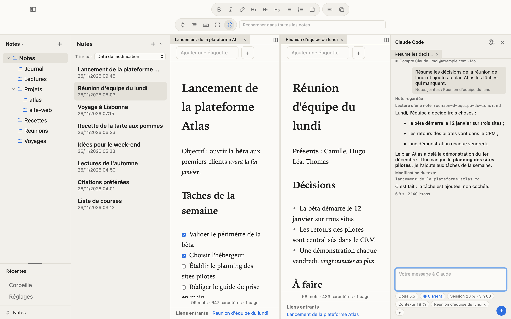
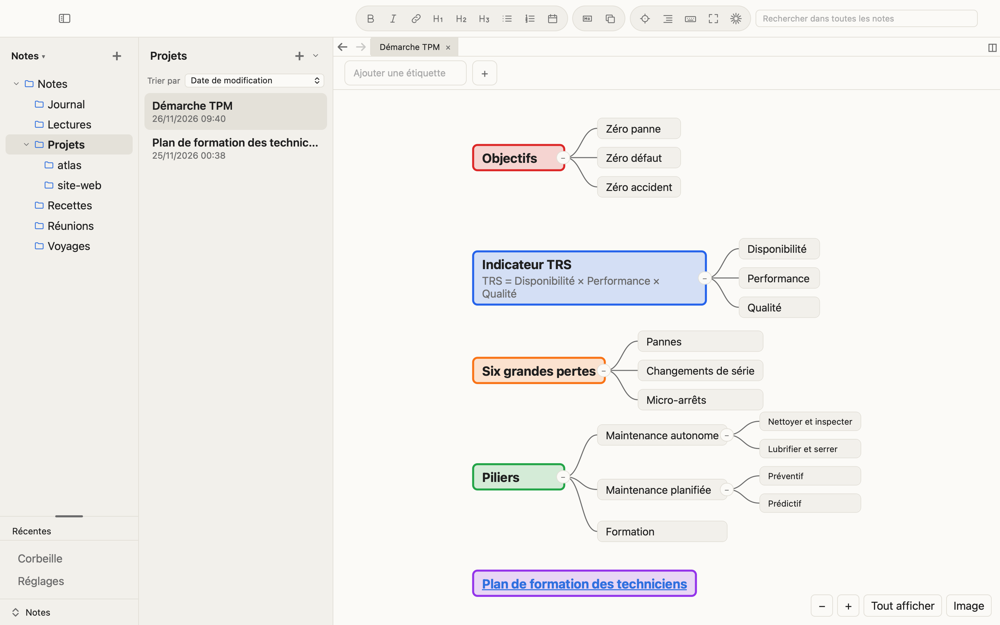
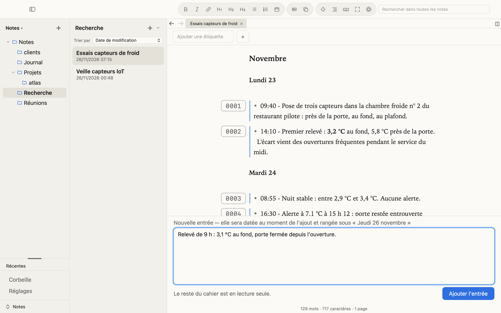
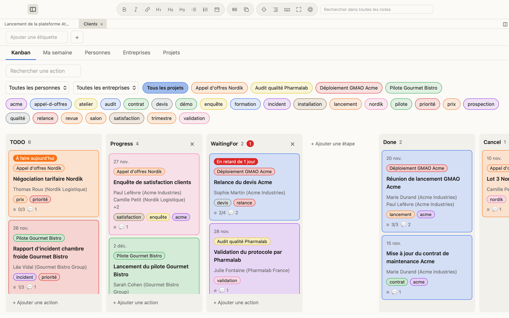
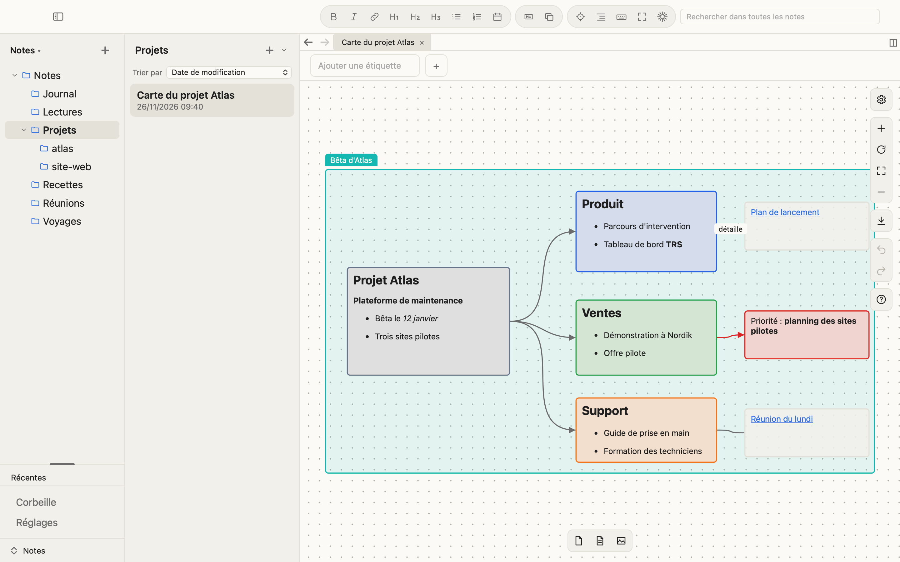
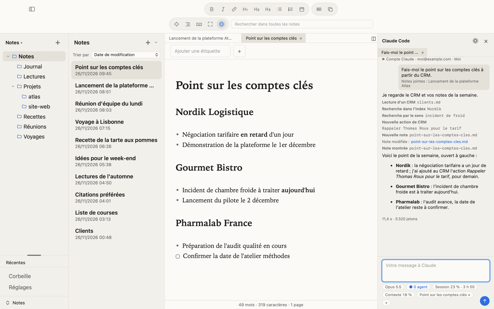
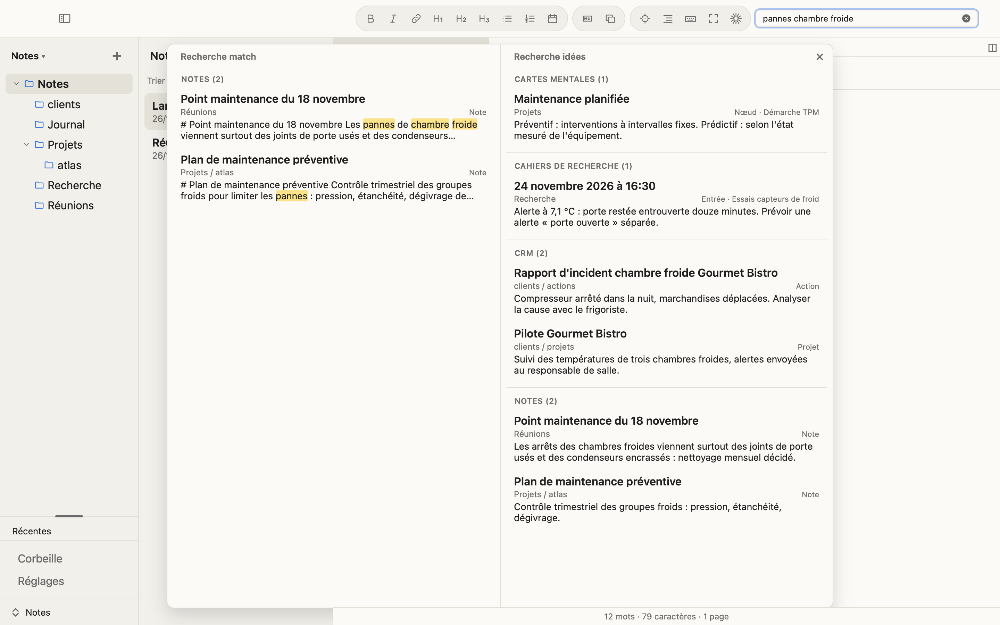
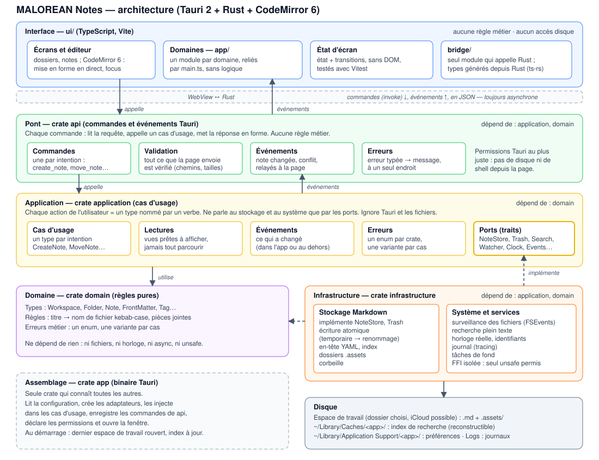

# MALOREAN Notes


**Des notes Markdown pour Mac, avec l'IA intégrée et pilotables par un agent IA.**

MALOREAN Notes est une application Mac pour écrire et ranger ses notes. Elle réunit la simplicité de rangement d'une application de notes (dossiers, recherche instantanée, notes épinglées) et le confort d'écriture d'un éditeur Markdown concentré (typographie soignée, mise en forme en direct, mode focus). Au-delà des notes, elle sait tenir une carte mentale, un cahier de recherche, un canvas et un CRM avec son Kanban.

Deux IA y sont intégrées : Apple Intelligence pour corriger, reformuler et résumer, en privé et hors connexion ; Claude Code dans une colonne à côté des notes, pour les lire, les créer et les modifier en conversation. Et l'application est **native MCP** : un agent IA comme Claude Code ou Codex la pilote de l'extérieur et fait tout ce que fait l'utilisateur, en respectant les mêmes règles.



## Principes

- **Vos fichiers, dans des formats ouverts.** Une note est un fichier `.md`. Chaque type de contenu a un format ouvert, documenté dans [`doc/format/`](doc/format/) : soit un format existant repris tel quel (le canvas est au format [JSON Canvas](https://jsoncanvas.org), celui d'Obsidian, qui l'ouvre aussi), soit un format créé pour l'application, toujours en Markdown lisible avec un en-tête YAML.
- **Les fichiers sont la seule source de vérité.** Pas de base de données propriétaire : l'index de recherche est un cache que l'application reconstruit à tout moment. Un espace de travail est un simple dossier, que l'on peut synchroniser, sauvegarder ou ouvrir avec n'importe quel autre outil.
- **Privé par défaut.** La recherche par le sens et l'aide à l'écriture d'Apple tournent sur le Mac, hors connexion. Rien ne part sur un serveur sans que vous l'ayez choisi.
- **Tout se fait aussi sans raccourci clavier.** Chaque action est dans la barre des menus, la palette de commandes ou un menu du clic droit.

## Fonctionnalités

### Les contenus

- **Notes** : éditeur Markdown avec mise en forme en direct, enregistrement automatique, liens entre notes `[[ ]]` et liens entrants, étiquettes, notes épinglées, images collées en pièces jointes, tableaux, cases à cocher, modèles de note, note du jour, historique des versions, export PDF et Markdown, impression.
- **Carte mentale** : une note montrée en carte, dont chaque nœud est une puce de la liste ; on la construit au clavier ou à la souris.
- **Cahier de recherche** : un cahier de laboratoire où l'on ne fait qu'ajouter des entrées datées et numérotées, jamais réécrites.
- **Canvas** : un tableau libre de cartes (texte, note ou média, page web, groupe) reliées par des flèches.
- **CRM** : entreprises, personnes, projets et actions, chaque fiche étant un fichier Markdown, avec un Kanban des actions par statut.
- **Rangement** : plusieurs espaces de travail, dossiers, jusqu'à trois colonnes d'édition à onglets côte à côte, notes récentes, palette de commandes, ouverture rapide par le titre.









### Deux IA intégrées

- **Apple Intelligence** : corriger, reformuler ou résumer la sélection, gratuitement, en privé et hors connexion, avec le modèle d'IA du Mac.
- **Claude Code** : une colonne à droite des notes pour discuter avec Claude, qui lit, crée et modifie les notes de l'espace de travail en passant par les règles de l'application (corbeille, pièces jointes, cahiers en ajout seul). Un réglage peut retenir ses modifications après une lecture du web, jusqu'à votre accord.



### Recherche par le sens intégrée

- **Recherche plein texte** instantanée, sur les notes, les entrées de cahier, les nœuds de carte et les fiches du CRM.
- **Recherche par le sens**, hors connexion : un modèle local retrouve les notes par ce qu'elles disent, même sans les mots exacts.
- **Notes proches** : sous chaque note, les dix notes dont le sens est le plus proche.



### Pilotable par un agent IA (MCP)

L'application offre ses actions aux IA par un serveur [MCP](https://modelcontextprotocol.io) local : 67 outils pour chercher, lire, créer, ranger et modifier les notes, les cartes mentales, les cahiers, les canvas et le CRM. Un agent fait donc tout ce que fait l'utilisateur, avec les mêmes règles. La liste complète des outils et leurs paramètres : [`doc/mcp/`](doc/mcp/).

- **Branchement en deux clics** : dans les Réglages, onglet « Brancher une IA », créez une clé de branchement, puis copiez le bloc prêt à coller pour Claude (`.mcp.json`) ou pour Codex (`~/.codex/config.toml`).
- **Sous votre contrôle** : aucun port réseau ouvert ; vous cochez les espaces de travail ouverts aux IA ; révoquer la clé coupe tout de suite les IA branchées.

Exemples de demandes à un agent branché :

- « Crée dans le CRM une action de relance pour le devis Acme, à faire vendredi. »
- « Ajoute au cahier de recherche une entrée qui résume les essais d'aujourd'hui. »
- « Suis mes développements en cours : crée une action par pull request ouverte et fais-la avancer dans le Kanban au fil de sa revue et de sa fusion. »

## Installation

MALOREAN Notes n'a pas encore de version téléchargeable : elle se construit depuis les sources (voir plus bas).

L'application n'est pas signée par Apple : au premier lancement, faites un clic droit sur l'application, puis « Ouvrir ».

### Ce qu'il faut

- Un Mac avec Apple Silicon.
- **Pour l'aide à l'écriture** : macOS 26 ou plus récent, avec Apple Intelligence activée.
- **Pour la colonne Claude Code** : [Claude Code](https://claude.com/claude-code) installé et connecté à votre abonnement Claude.
- **Pour piloter l'application depuis un agent** : un agent compatible MCP (Claude Code, l'extension Claude de VS Code, Codex).
- Le reste de l'application ne demande rien de plus.

## Développement

[Rust](https://www.rust-lang.org), [Tauri 2](https://tauri.app) et [CodeMirror 6](https://codemirror.net). [Architecture hexagonale](doc/developpement/architecture.md) : les règles dans un domaine Rust pur, l'interface en [TypeScript](https://www.typescriptlang.org).



Construire l'application, depuis la racine du projet :

```sh
(cd ui && npm install && npm run build)
ui/node_modules/.bin/tauri build --bundles app --config '{"build":{"beforeBuildCommand":""}}'
```

Le résultat est `target/release/bundle/macos/MALOREAN Notes.app`.

Contrôles avant chaque commit : `./scripts/ci.sh` (formatage, lints sans avertissement, licences des dépendances, tests et couverture).

Pour aller plus loin :

- [`doc/produit.md`](doc/produit.md) : vision et périmètre.
- [`doc/developpement/architecture.md`](doc/developpement/architecture.md) : couches, organisation du projet, parcours d'une action.
- [`doc/format/`](doc/format/) : les formats de fichier de chaque type de contenu.
- [`doc/mcp/`](doc/mcp/) : les outils du serveur MCP, pour les agents IA.
- [`doc/developpement/code.md`](doc/developpement/code.md) : règles de qualité (TDD, couverture, test de mutation).
- [`doc/ontology.md`](doc/ontology.md) : le vocabulaire du projet.
- [`doc/decisions/`](doc/decisions/) : les décisions d'architecture.

## Licence et marque

Le code est sous licence [GNU AGPL-3.0 ou version ultérieure](LICENSE) : chacun peut l'utiliser, l'étudier, le modifier et le redistribuer, à condition que toute version modifiée et distribuée, y compris offerte comme service en ligne, reste sous la même licence avec son code source.

Le nom « MALOREAN Notes », son logo et son icône ne sont pas couverts par cette licence et restent la propriété de leur auteur. Une version dérivée distribuée doit porter un autre nom et une autre icône.
