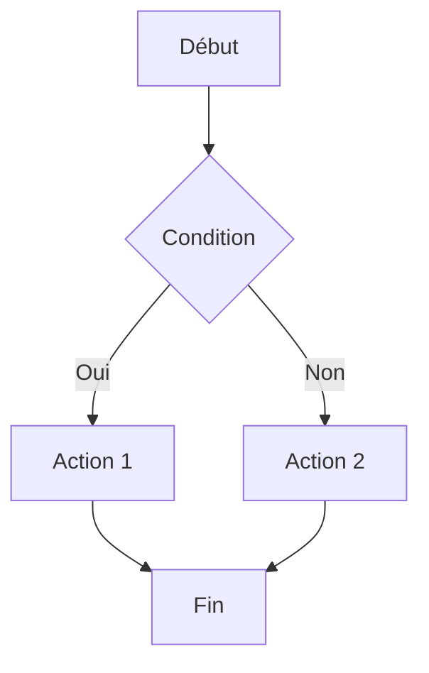

# NOTE_FAKE

## Titre de niveau 2

### Titre de niveau 3

#### Titre de niveau 4

##### Titre de niveau 5

###### Titre de niveau 6

---

## 1. Paragraphes

Ceci est un premier paragraphe. Il contient plusieurs phrases pour tester le retour à la ligne automatique, la lecture et la mise en page. Le texte est volontairement long afin de vérifier que le rendu reste lisible quand une ligne dépasse la largeur de la fenêtre.

Ceci est un second paragraphe, séparé du premier par une ligne vide. Il sert à vérifier l'espacement entre deux blocs de texte.

Ceci est une ligne avec un retour à la ligne forcé.  
Cette ligne est la suite, juste en dessous.

---

## 2. Mise en forme du texte

- **Gras**
- *Italique*
- ***Gras et italique***
- ~~Barré~~
- ==Surligné==
- `Code en ligne`
- Texte avec **gras**, *italique* et `code` dans la même phrase
- Exposant : x^2^ et indice : H~2~O
- Caractères échappés : \*pas d'italique\*, \# pas un titre, \[pas un lien\]

---

## 3. Listes à puces

- Premier élément
- Deuxième élément
- Troisième élément
  - Sous-élément A
  - Sous-élément B
    - Sous-sous-élément 1
    - Sous-sous-élément 2
      - Niveau 4
  - Sous-élément C
- Quatrième élément avec **gras**, *italique* et `code`
- Cinquième élément avec un texte très long qui passe sur plusieurs lignes pour vérifier que l'indentation de la puce reste correcte quand le contenu dépasse la largeur disponible

* Liste avec astérisques
* Deuxième élément

+ Liste avec plus
+ Deuxième élément

---

## 4. Listes numérotées

1. Première étape
2. Deuxième étape
3. Troisième étape
   1. Sous-étape 3.1
   2. Sous-étape 3.2
      1. Détail 3.2.1
   3. Sous-étape 3.3
4. Quatrième étape
5. Cinquième étape

Liste qui ne commence pas à 1 :

5. Cinq
6. Six
7. Sept

Liste mixte :

1. Étape numérotée
   - Puce dans une étape
   - Autre puce
2. Autre étape numérotée
   - Puce encore

---

## 5. Cases à cocher

- [ ] Tâche à faire
- [x] Tâche terminée
- [ ] Tâche avec **gras** et `code`
- [x] ~~Tâche barrée et terminée~~
- [ ] Tâche parente
  - [x] Sous-tâche terminée
  - [ ] Sous-tâche à faire
  - [ ] Autre sous-tâche

---

## 6. Citations

> Ceci est une citation simple.

> Ceci est une citation sur plusieurs lignes.
> Elle continue ici.
> Et se termine là.

> Citation de premier niveau
>
> > Citation imbriquée de second niveau
> >
> > > Citation de troisième niveau

> **Citation avec mise en forme**
>
> - Une puce dans une citation
> - Une autre puce
>
> Et un paragraphe avec `du code`.

---

## 7. Blocs de code

Code en ligne : utiliser la commande `git status` pour voir l'état.

Bloc sans langage :

```
Texte brut dans un bloc de code.
    Les espaces sont conservés.
Ligne suivante.
```

Bloc Python :

```python
def fibonacci(n: int) -> list[int]:
    """Retourne les n premiers termes de la suite de Fibonacci."""
    suite = [0, 1]
    while len(suite) < n:
        suite.append(suite[-1] + suite[-2])
    return suite[:n]


if __name__ == "__main__":
    print(fibonacci(10))
```

Bloc JavaScript :

```javascript
const utilisateurs = [
  { nom: "Alice", age: 30 },
  { nom: "Bob", age: 25 },
];

const adultes = utilisateurs
  .filter((u) => u.age >= 18)
  .map((u) => `${u.nom} (${u.age} ans)`);

console.log(adultes);
```

Bloc TypeScript :

```typescript
interface Equipement {
  id: string;
  nom: string;
  actif: boolean;
}

function activer(e: Equipement): Equipement {
  return { ...e, actif: true };
}
```

Bloc Bash :

```bash
#!/usr/bin/env bash
set -euo pipefail

for fichier in *.md; do
  echo "Traitement de $fichier"
  wc -l "$fichier"
done
```

Bloc SQL :

```sql
SELECT e.nom,
       COUNT(o.id) AS nb_ordres
FROM equipement e
LEFT JOIN ordre_travail o ON o.equipement_id = e.id
WHERE e.actif = 1
GROUP BY e.nom
ORDER BY nb_ordres DESC
LIMIT 10;
```

Bloc JSON :

```json
{
  "nom": "NOTE_FAKE",
  "version": 1,
  "tags": ["test", "fake"],
  "actif": true,
  "options": {
    "theme": "sombre",
    "taille": 14
  }
}
```

Bloc YAML :

```yaml
service:
  nom: api
  port: 8080
  variables:
    - CLE=valeur
    - MODE=test
```

Bloc HTML :

```html
<div class="carte">
  <h2>Titre</h2>
  <p>Un paragraphe avec <strong>du gras</strong>.</p>
</div>
```

Bloc CSS :

```css
.carte {
  display: flex;
  gap: 1rem;
  border: 1px solid #ccc;
  border-radius: 8px;
}
```

Bloc diff :

```diff
- ancienne ligne
+ nouvelle ligne
  ligne inchangée
```

Bloc avec des backticks à l'intérieur :

````markdown
Voici un exemple de bloc de code dans un bloc de code :

```python
print("bonjour")
```
````

---

## 8. Tableaux

| Colonne A | Colonne B | Colonne C |
|-----------|-----------|-----------|
| 1         | Texte     | **Gras**  |
| 2         | Autre     | `code`    |
| 3         | Dernier   | *italique* |

Alignements :

| Gauche | Centre | Droite |
|:-------|:------:|-------:|
| a      |   b    |      c |
| 10     |  200   |   3000 |

---

## 9. Liens

- Lien externe : [Exemple](https://example.com)
- Lien avec titre : [Exemple](https://example.com "Titre au survol")
- Lien automatique : <https://example.com>
- Adresse e-mail : <contact@example.com>
- Lien interne vers une note : [[CAHIER_RECHERCHE_FAKE]]
- Lien interne avec alias : [[CAHIER_RECHERCHE_FAKE|le cahier de test]]
- Lien interne vers un titre : [[CAHIER_RECHERCHE_FAKE#Sujet]]

---

## 10. Étiquettes

#test #fake #note-longue #mcp

---

## 11. Notes de bas de page

Une phrase avec une note de bas de page[^1] et une autre[^2].

[^1]: Contenu de la première note de bas de page.
[^2]: Contenu de la seconde note, plus longue, avec du **gras** et du `code`.

---

## 12. Formules

Formule en ligne : $E = mc^2$

Formule en bloc :

$$
\int_0^1 x^2 \, dx = \frac{1}{3}
$$

---

## 13. Diagramme



---

## 14. Définitions et divers

Terme
: Définition du terme sur la ligne suivante.

Autre terme
: Autre définition.

Texte avec une abréviation : le HTML est un langage de balisage.

Émojis : ✅ ❌ ⚠️ 💡 📌 🚀

Caractères spéciaux : é è ê à ù ç ô î ï œ « guillemets » — tiret long – tiret moyen … points de suspension

Symboles : © ® ™ € £ ° ± × ÷ ≠ ≤ ≥ → ← ↑ ↓

<!-- Ceci est un commentaire HTML, normalement invisible -->

---

## 15. Blocs d'avertissement

> [!NOTE]
> Information utile à connaître.

> [!TIP]
> Conseil pratique.

> [!IMPORTANT]
> Point important à ne pas manquer.

> [!WARNING]
> Attention, risque de perte de données.

> [!CAUTION]
> Action potentiellement dangereuse.

---

## 16. Contenu imbriqué

1. Étape avec un bloc de code :

   ```bash
   echo "dans une liste"
   ```

2. Étape avec une citation :

   > Citation dans une liste numérotée.

3. Étape avec un paragraphe supplémentaire.

   Ce second paragraphe reste rattaché à l'étape 3.

- Puce avec un bloc de code :

  ```python
  print("dans une puce")
  ```

- Puce avec **gras**, *italique* et un [lien](https://example.com).

---

## 17. Texte long

Lorem ipsum dolor sit amet, consectetur adipiscing elit. Sed do eiusmod tempor incididunt ut labore et dolore magna aliqua. Ut enim ad minim veniam, quis nostrud exercitation ullamco laboris nisi ut aliquip ex ea commodo consequat. Duis aute irure dolor in reprehenderit in voluptate velit esse cillum dolore eu fugiat nulla pariatur.

Excepteur sint occaecat cupidatat non proident, sunt in culpa qui officia deserunt mollit anim id est laborum. Curabitur pretium tincidunt lacus. Nulla gravida orci a odio. Nullam varius, turpis et commodo pharetra, est eros bibendum elit, nec luctus magna felis sollicitudin mauris.

Integer in mauris eu nibh euismod gravida. Duis ac tellus et risus vulputate vehicula. Donec lobortis risus a elit. Etiam tempor. Ut ullamcorper, ligula eu tempor congue, eros est euismod turpis, id tincidunt sapien risus a quam.

---

*Fin de la note de test.*