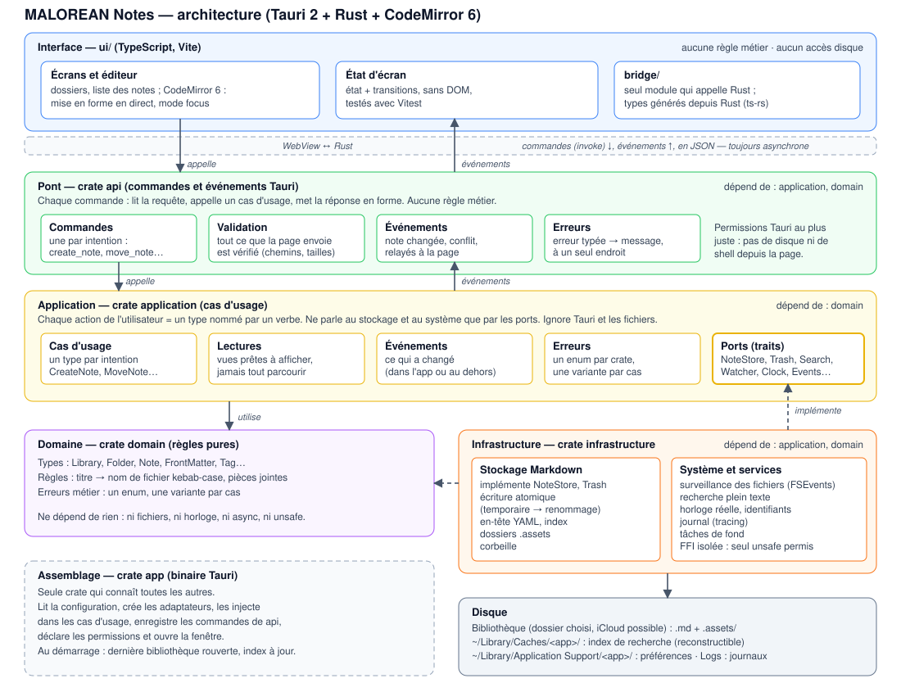

# Architecture



Produit : `doc/produit.md`. Règles de qualité et contrôles : `doc/code.md`. Vocabulaire : `doc/ontology.md`.

## Organisation du projet

```
Cargo.toml            workspace, dépendances et lints communs
clippy.toml           seuils et méthodes interdites
crates/
  domain/             règles pures, types, erreurs métier
  application/        cas d'usage, lectures, événements, ports (traits)
  infrastructure/     stockage Markdown, historique des versions, index SQLite, fichiers exportés, presse-papiers, assistant d'écriture (assistant Swift du modèle d'Apple, swift/), pilote de Claude Code (outil `claude` installé), système macOS, horloge réelle, journal
  api/                pont Tauri : commandes et événements, types exportés en TypeScript
  app/                binaire Tauri : assemblage, configuration, permissions, programme annexe (assistant Swift)
ui/                   interface TypeScript (Vite)
  src/main.ts         assemblage : crée chaque partie et les relie, sans logique
  src/app/            un module par domaine, branché par main.ts : colonnes et onglets,
                      disposition gardée, dossiers pliés gardés, espace de travail, dossiers, demandes de l'écran, modèles, journal, recherche, corbeille, enregistrement,
                      modifications extérieures, historique, aide à l'écriture, outils d'écriture, réglages, export, commandes, barre des menus, boutons de la fenêtre
  src/bridge/         seul module qui appelle Rust ; types générés
  src/editor/         éditeur CodeMirror 6, une extension par fonctionnalité
  src/rendering/      rendu HTML d'une note (export PDF, impression, copie mise en forme), styles en ligne, texte brut
  src/screens/        écrans : dossiers, liste des notes, éditeur
  src/state/          état d'écran et transitions, testés sans navigateur
scripts/ci.sh         mini CI locale, avant chaque push
scripts/ui-mutations.sh   test de mutation de l'interface (appelé par ci.sh) ; ses scénarios de preuve : test-ui-mutations.sh
```

Sens des dépendances : `api` → `application` → `domain` ; `infrastructure` → `application` → `domain` ; `app` → tout ; `ui/` → commandes de `api` uniquement.

## Principes

- **Les dépendances vont vers le stable** : le domaine change le moins et ne dépend de rien ; ce qui change souvent (interface, stockage, système macOS) dépend de lui, jamais l'inverse.
- **Ports et adaptateurs** : un **port d'entrée** est un cas d'usage, appelé par `api` ; un **port de sortie** est un trait défini par `application` dans ses propres mots, implémenté par `infrastructure`. Changer de format de fichier ou d'interface ne touche ni le domaine ni les cas d'usage.
- **Cœur pur, coque mince** : les décisions sont des fonctions pures du domaine ; les effets (disque, horloge, événements) restent en bordure, dans les cas d'usage et les adaptateurs.
- **Ce qui change ensemble vit ensemble** : un module regroupe le code qui évolue pour une même raison. Une évolution qui oblige à toucher beaucoup de modules signale un mauvais découpage.
- **Convertir à la frontière** : une donnée venue du dehors (page, fichier) devient un type du domaine dès son entrée dans `api` ou `infrastructure`. À l'intérieur, tout est déjà valide.

## Parcours d'une action

1. L'utilisateur agit (frappe, clic, raccourci, menu). L'écran prévient le module de son domaine (`ui/src/app/`), qui appelle une fonction de `ui/src/bridge/`.
2. Le pont envoie une commande Tauri ; la page reste libre pendant ce temps.
3. La commande valide la requête et appelle un cas d'usage, qui lit via les ports, applique les règles du domaine, écrit via les ports.
4. Le cas d'usage publie un événement « ce qui a changé » ; `api` le relaie à la page.
5. L'écran met à jour son état ; l'affichage suit l'état.

En cas d'erreur : le cas d'usage rend une erreur typée ; `api` la traduit en message à un seul endroit.

## Fils d'exécution

- **Page (WebView)** : affichage et saisie uniquement ; appels à Rust toujours asynchrones.
- **Rust en arrière-plan** : cas d'usage, disque, index, recherche. Communication avec la page par commandes et événements uniquement.

## Données

| Emplacement | Contenu | Perte acceptable ? |
|---|---|---|
| Espace de travail (dossier choisi par l'utilisateur, iCloud Drive possible) | notes `.md`, dossiers, pièces jointes — **seule source de vérité** | non |
| `.history/` dans l'espace de travail (caché) | versions de chaque note, copies Markdown datées à son chemin (port `History`, adaptateur `FsHistory`, fiche 0030) ; celles des notes jetées dans `.trash/.history/` | non |
| `~/Library/Application Support/<app>/` | préférences (`preferences.json`) : liste des espaces de travail (nom, dossier) et celui ouvert en dernier, port `Preferences` | non |
| `~/Library/Application Support/<app>/index-<empreinte>.sqlite` | index de chaque espace de travail (port `NoteIndex`, adaptateur `SqliteIndex`) : titre, étiquettes, épinglage, date, taille et texte de chaque note ; jamais dans l'espace de travail ni dans iCloud ; reconstructible à partir des fichiers (fiche 0028) | oui |
| Stockage de la page (WebView) | réglages de confort : réglages, mode focus, mode machine à écrire, panneaux latéraux, dossier du dernier export ; disposition des colonnes, dossier des modèles, réglages du journal, dossiers pliés, tri de la liste et notes récentes de chaque espace de travail, rangés sous son dossier (renommer l'espace ne les perd pas) ; un réglage illisible reprend sa valeur par défaut, une disposition illisible est ignorée | oui |
| `~/Library/Caches/<app>/` | aperçus — reconstructibles | oui |
| `~/Library/Logs/<app>/` | journaux | oui |
| Trousseau macOS | secrets éventuels | non |

- Toute écriture dans l'espace de travail est atomique (fichier temporaire puis renommage) : un fichier n'est jamais à moitié écrit.
- La surveillance des fichiers (port `WorkspaceWatcher`, adaptateur FSEvents dans `infrastructure`) détecte les modifications extérieures ; `api` les relaie à la page par l'événement `workspace-changed`. L'application recharge la note, ou garde l'autre version dans une copie de conflit : rien n'est perdu (fiche 0014).
- La liste des notes, le tri, le filtre par étiquette, la liste des étiquettes et la recherche lisent l'index, jamais les fichiers. L'index suit les fichiers : `IndexedStore` le met à jour à chaque écriture, déplacement et mise à la corbeille faits par l'application ; à l'ouverture d'un espace de travail et à chaque changement venu de la surveillance (avant de l'annoncer à la page), il relit seulement les notes dont le relevé (date, taille) a changé ; « Reconstruire l'index » le refait entièrement. Un index abîmé ou d'un ancien format est remplacé (fiche 0028).
- L'historique suit les notes : `VersionedStore` (sous `IndexedStore`) emporte les versions d'une note déplacée, renommée, jetée ou restaurée. Une version est gardée après 5 minutes de frappe, en quittant la note ou l'application, avant une restauration, et, à chaque annonce de la surveillance, avant que l'index ne suive : le texte qu'il connaissait est gardé s'il n'est plus celui du disque (fiche 0030).
- Les liens entre notes (`[[titre]]`) et les liens entrants sont calculés à la demande en relisant les notes (fiche 0016).
- Les colonnes et leurs onglets sont un état de l'interface seule ; chaque colonne a son éditeur et charge la note de son onglet actif ; une note montrée dans plusieurs colonnes n'a qu'un texte et qu'un enregistrement automatique, partagés entre leurs éditeurs (fiche 0017).
- Un export écrit hors de l'espace de travail, là où l'utilisateur l'a choisi : le Markdown et ses pièces jointes par le port `ExportStore`, le PDF par l'impression de la page par WebKit (fiche 0025). Imprimer ouvre la fenêtre d'impression du Mac sur la même page (fiche 0026). Copier en texte mis en forme pose le même rendu, aux styles en ligne, et le texte brut dans le presse-papiers du Mac par le port `Clipboard` ; copier en Markdown y pose le texte de la note seul, tel quel (fiche 0027).
- La barre des menus du Mac est décrite par la page (`ui/src/state/app-menu.ts`, tirée de la liste des commandes) et construite par Rust (`install_menu`) ; un élément choisi revient à la page par l'événement `menu-command` et lance la même commande que la palette. Les touches passent d'abord par la page, qui empêche WebKit de les donner au menu quand elle les prend (fiche 0029).
- L'aide à l'écriture ne garde rien et n'écrit rien : la sélection part au port `WritingAssistant`, dont l'adaptateur lance l'assistant Swift `malorean-writing` (programme annexe posé à côté de celui de l'application) qui interroge le modèle d'IA du Mac ; la proposition revient à la page, qui ne change la note qu'avec l'accord de l'utilisateur, comme une frappe (fiche 0031).
- Claude Code est piloté par le port `ClaudeCode` (`application`) : un tour (`send`) donne chaque événement de Claude (`domain::claude::ClaudeEvent`) dès qu'il arrive et rend la main à la fin ; `stop` arrête le tour en cours. L'adaptateur `ClaudeCodeCli` lance le programme `claude` dans le dossier de l'espace de travail, avec les options des autorisations de Claude, écrit le message sur son entrée, sans `ANTHROPIC_API_KEY`, et traduit son flux JSON ligne à ligne (`claude_stream`, lignes inconnues ignorées) ; un tour à la fois (fiche 0032).
- La colonne Claude Code ne garde rien sur le disque : chaque message part au port `ClaudeCode`, dont l'adaptateur lance l'outil `claude` installé dans le dossier de l'espace de travail, en mode non interactif, limité par ses options aux fichiers de ce dossier (ni commande système, ni web) ; chaque ligne de son flux JSON devient un événement de Claude relayé à la page. Claude écrit lui-même les notes ; la surveillance des fichiers les fait suivre comme toute modification extérieure. Seul l'identifiant de la conversation est gardé, en mémoire (fiche 0032).
- L'application n'impose aucun format : un fichier `.md` écrit par un autre outil est une note valide.

## Décisions d'architecture

Chaque décision qui engage la structure (technologie, format des données, découpage, dépendance importante) a sa fiche dans `doc/decisions/`, numérotée et datée : `NNNN-titre-en-kebab-case.md`. Une fiche contient quatre parties : **Contexte** (le problème et ses contraintes), **Décision**, **Conséquences** (ce qu'on gagne, ce qu'on perd), **Statut** (proposée, acceptée, remplacée par…). Une décision acceptée ne se modifie pas : on écrit une nouvelle fiche qui la remplace.

| Fiche | Décision |
|---|---|
| `0001-tauri-codemirror.md` | Interface Tauri 2 + CodeMirror 6 |
| `0002-notes-markdown-nom-tire-du-titre.md` | Notes en fichiers Markdown, nom tiré du titre, pièces jointes par note |
| `0003-apercu-en-direct-par-masquage.md` | Aperçu en direct : syntaxe masquée hors de la ligne en cours |
| `0004-strategie-de-tests.md` | Niveaux de tests, seuils, mutation, garde-fou avant envoi |
| `0005-aide-ecriture-modele-apple.md` | Aide à l'écriture par le modèle d'IA du Mac, sans compte ni clé |
| `0006-seuils-et-mutation-a-chaque-envoi.md` | Seuils qui ne baissent jamais, test de mutation à chaque envoi |
| `0007-images-par-le-protocole-asset.md` | Images des notes : chargées par le protocole `asset` de Tauri |
| `0008-sous-dossiers.md` | Sous-dossiers : une note est désignée par son chemin depuis l'espace de travail |
| `0009-recherche-plein-texte.md` | Recherche plein texte : relire les notes à chaque recherche, en Rust |
| `0010-notes-epinglees.md` | Notes épinglées : `pinned: true` dans l'en-tête de la note |
| `0011-mode-focus.md` | Mode focus : calculé dans l'éditeur, réglage gardé par la page |
| `0012-corbeille.md` | Corbeille : un dossier caché `.trash/` qui garde le chemin d'origine |
| `0013-pieces-jointes-collees.md` | Pièces jointes collées ou glissées : octets envoyés à Rust, nom décidé par le domaine |
| `0014-modifications-externes.md` | Modifications faites hors de l'application : recharger, ou garder les deux versions |
| `0015-ci-avant-chaque-commit.md` | La mini CI avant chaque commit, plus rien à l'envoi |
| `0016-liens-entre-notes.md` | Liens entre notes : `[[titre]]`, résolus par le titre à la demande |
| `0017-colonnes-et-onglets.md` | Colonnes et onglets : un état pur dans l'interface, un éditeur par colonne |
| `0018-plein-ecran-et-panneaux-lateraux.md` | Plein écran et panneaux latéraux : deux réglages indépendants |
| `0019-modeles-de-note.md` | Modèles de note : un dossier choisi dans les réglages, la note créée par Rust |
| `0020-etiquettes.md` | Étiquettes : lues dans l'en-tête par Rust, un filtre sur tout l'espace de travail |
| `0021-tri-de-la-liste.md` | Tri de la liste : choisi par l'interface, rangé par Rust |
| `0022-notes-recentes.md` | Notes récentes : tenues par l'interface, relues par Rust |
| `0023-note-du-jour.md` | Note du jour : un fichier daté dans le journal, créé par Rust, ouvert au lancement |
| `0024-espaces-de-travail.md` | Espaces de travail : une liste gardée par Rust, chaque espace désigné par son nom |
| `0025-export-pdf-et-markdown.md` | Export : le Markdown écrit par Rust, le PDF imprimé par WebKit depuis le rendu HTML de la note |
| `0026-imprimer.md` | Imprimer : la feuille d'impression de l'export, dans la fenêtre d'impression du Mac ouverte par le même module natif |
| `0027-copier-en-texte-mis-en-forme.md` | Copier en texte mis en forme : le presse-papiers du Mac écrit par Rust (port `Clipboard`), en HTML aux styles en ligne et en texte brut ; copier en Markdown, en texte brut seul |
| `0028-index-sqlite.md` | Index : une base SQLite (FTS5) par espace de travail, dans le dossier de support de l'application, que les fichiers peuvent toujours reconstruire |
| `0029-barre-des-menus.md` | Barre des menus du Mac : décrite par la page à partir de la liste des commandes, construite par Rust |
| `0030-historique-des-versions.md` | Historique des versions : des copies Markdown datées dans `.history/`, sans Git ; règles de conservation et différences dans le domaine |
| `0031-aide-ecriture-assistant-swift.md` | Aide à l'écriture : le modèle d'Apple par un assistant Swift lancé à chaque demande (programme annexe, JSON), découpage et consignes dans le domaine, proposition acceptée avant toute modification |
| `0032-colonne-claude-code.md` | Colonne Claude Code : l'outil `claude` installé, piloté en arrière-plan en flux JSON avec l'abonnement de l'utilisateur, limité par ses options aux notes de l'espace de travail ; un faux `claude` dans les tests |

## Décisions ouvertes

- Cibles de performance (taille d'espace de travail, temps d'ouverture, temps de recherche, mémoire). Premier relevé, 2 000 notes, index à jour : ouverture 10 ms, liste d'un dossier 0,8 ms, recherche 1,5 à 12 ms (fiche 0028).
