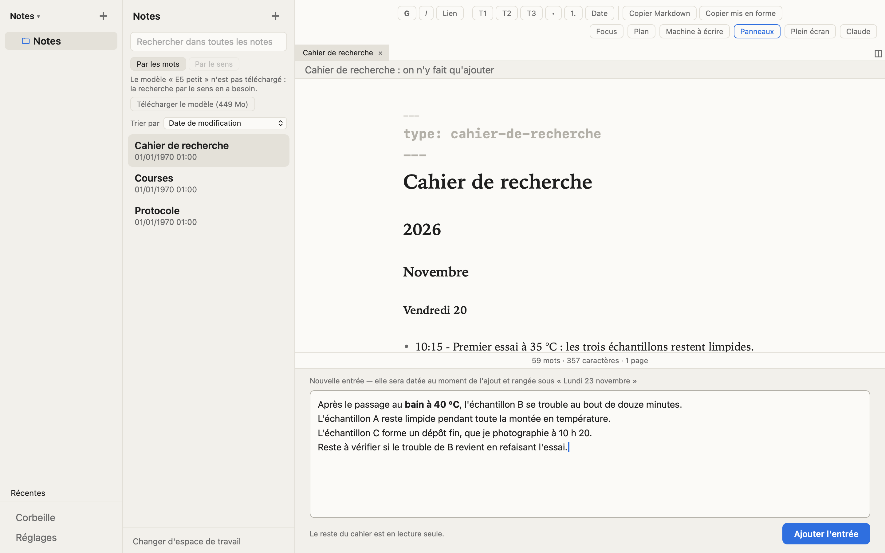

# Écrire une entrée de cahier de recherche

Spécification fonctionnelle, refaite le 23/11 (version simple, remplace la précédente). Elle complète la fonction « Cahier de recherche » (entrées ajoutées, jamais modifiées). Ce document se lit seul. Le format du fichier d'un cahier (en-tête, titres d'année, de mois et de jour, syntaxe des entrées, heures, ancres, numéros, ce que l'application lit et écrit) est décrit dans `doc/format/cahier-de-recherche.md`, seule référence sur ce point.



## 1. Besoin

Ajouter une observation à un cahier de recherche simplement, sans fenêtre ni colonne en plus, en voyant le cahier au-dessus.

## 2. Comportement

- Le cahier est une note comme les autres, ouverte dans sa colonne. **Son texte n'est pas modifiable** : on ne peut rien y changer, ni dans les entrées ni dans les titres.
- **On ne saisit qu'en bas de la page** : une zone de saisie fait partie de la page du cahier, sous son texte. Elle montre **8 lignes** à la fois (au-delà, elle défile) et accepte un texte libre sur plusieurs lignes.
- Un seul bouton, **« Ajouter l'entrée »**, sous la zone de saisie. Un message au-dessus dit où l'entrée sera rangée (« elle sera datée au moment de l'ajout et rangée sous « Lundi 23 novembre » »).
- À l'ajout, l'entrée est **datée du moment de l'ajout** et rangée à la fin du cahier, sous le titre de son jour (créé s'il n'existe pas encore), comme dans un cahier papier : la plus ancienne en haut, la plus récente en bas. L'écriture dans le fichier est décrite dans `doc/format/cahier-de-recherche.md`. La zone de saisie se vide ensuite.
- **Étiquettes** : comme pour tout contenu, le champ d'étiquettes est sous les onglets de la colonne (étiquettes en pastilles avec « × », champ « Ajouter une étiquette » et « + »). C'est la seule chose modifiable en dehors de la zone de saisie : un geste réécrit seulement `tags` dans l'en-tête, le texte du cahier reste tel quel.
- **Pas de correction** : aucune entrée ne se modifie, et il n'y a aucun bouton « Corriger ». Une erreur se rectifie par une nouvelle entrée.

## 2 bis. Repérer les entrées

- Chaque entrée du cahier porte, **sur son côté gauche, une barre verticale** : elle couvre toute la hauteur de l'entrée (sa première ligne, ses lignes suivantes, ses paragraphes en retrait et ses sous-puces), pour distinguer d'un coup d'œil une entrée de la suivante. **Elle est continue et exactement au même endroit sur toutes les lignes de l'entrée**, quel que soit leur contenu (citation, citation imbriquée, bloc de code, liste, tableau, ligne vide) ; le trait propre à une citation reste visible, à l'intérieur de l'entrée, à droite de la barre, sans la remplacer.
- Deux entrées successives sont **séparées par un espace net** : leurs deux barres ne se touchent pas.
- La barre est d'une teinte discrète du thème, lisible en clair comme en sombre.
- Cela ne concerne que les cahiers de recherche : les listes des autres notes ne changent pas. La barre est un simple affichage, le texte du cahier n'en est pas changé.

## 2 ter. Numéroter les entrées (26/11)

But : citer facilement une entrée. Rendu dans la marge gauche, en face de la première ligne de chaque entrée, à côté de la barre :

```
 ┌────────┐ ┃ • 14:12 — Étape 1 …
 │  0001  │ ┃   suite de l'entrée
 └────────┘ ┃
 ┌────────┐ ┃ • 15:03 — Étape 2 …
 │  0002  │ ┃
 └────────┘
```

- Chaque entrée porte un **numéro d'entrée** : sa position dans le cahier (définie dans `doc/format/cahier-de-recherche.md`). La première est `0001`, la deuxième `0002`, etc. Il s'écrit sur **4 chiffres** ; au-delà de 9999 entrées, le nombre est écrit en entier (`10000`), sans être coupé.
- Le numéro est dans un **rectangle aux coins arrondis**, au contour lisible du thème (clair comme sombre), dans la marge à gauche de l'entrée, **centré sur sa première ligne**. Il est **assez grand pour se lire et se viser** : chiffres de la même taille que le texte du cahier (18 px par défaut, il suit le réglage de taille du texte), hauteur de 32 px (la cible de clic du projet), largeur de 71 px pour 4 chiffres (avant : 48 × 19 px, texte de 11 px, jugé « bien trop petit »). Plus haut que la ligne, il déborde dans la marge sans repousser les lignes ni créer d'espace entre entrées ; deux numéros voisins restent séparés d'au moins 12 px. Le texte ne bouge pas d'une entrée à l'autre ; la marge du cahier est élargie (92 px) pour que le rectangle ne recouvre jamais le texte, même dans une colonne étroite ou avec un nombre de 5 chiffres. Survol et focus clavier restent marqués (contour de l'accent).
- Le numéro d'une entrée est stable et **les cahiers existants sont numérotés d'office**. Un cahier vide n'affiche aucun numéro ; une entrée ajoutée apparaît avec le numéro suivant, sans recharger.
- **Le numéro est un bouton** (« Copier la référence de l'entrée 0007 », au clavier comme à la souris). Un clic copie dans le presse-papiers la **référence** de l'entrée, un lien entre notes avec ancre : `[[Titre du cahier#0007]]` (titre `#` du cahier, ou à défaut le nom de son fichier, puis `#` et le numéro sur 4 chiffres) ; le message « Référence copiée » le confirme.
- **Le lien vers une entrée** (28/11) : collée dans une note (une autre, ou le cahier lui-même), la référence est un lien entre notes comme les autres, avec une ancre, à la façon d'un lien HTML `page#ancre`. Un clic sur son texte, comme sur tout lien entre notes, ouvre le cahier de recherche (celui déjà ouvert dans une colonne sert, sans le rouvrir) **et fait défiler jusqu'à l'entrée**, qu'il met brièvement en évidence (couleur et durée du thème, lisibles en clair comme en sombre). Si le numéro n'existe pas (`0000`, ou au-delà de la dernière entrée), le cahier s'ouvre sans défiler et le message « Entrée 0007 introuvable dans ce cahier » le dit.
- Règles du lien : `#` suivi de chiffres seuls, sur un lien dont la cible désigne un cahier de recherche. Le texte entier est d'abord pris pour un titre : un cahier ou une note dont le titre contient `#` reste lié comme avant. Un cahier homonyme d'un autre contenu suit la règle des liens ambigus (écrire le dossier : `[[Labo/Levures#0007]]`). Les liens existants (`[[titre]]`, `[[Dossier/titre]]`, `[[nom.canvas]]`, `[[titre|texte]]`) ne changent pas. Dans « Liens vers cette note », un lien vers une entrée compte comme un lien vers le cahier.
- Hors périmètre : une renumérotation, une recherche par numéro.
- L'outil de l'application pour Claude (« ajouter une entrée ») rend aussi le numéro de l'entrée ajoutée.

## 3. Ce qui disparaît

- La fenêtre de saisie « Ajouter au cahier », sa liste déroulante de choix du cahier et son bouton « Ajouter ».
- Le « + » en haut du cahier.
- La commande « Ajouter au cahier » (palette et barre des menus) : elle n'existe plus.
- Les brouillons, les colonnes de brouillon et les boutons « Corriger » (pensés dans la version précédente de cette spécification).

## 4. Décidé par l'utilisateur (23/11)

- **Il n'y a pas de commande « Ajouter au cahier »** (ni dans la palette ni dans la barre des menus) : on ajoute une entrée seulement depuis la page du cahier de recherche, par la zone de saisie en bas. Hors d'un cahier, rien n'apparaît.
- L'outil de l'application pour Claude (« ajouter une entrée au cahier ») ne change pas ; seule sa partie « correction » disparaît avec la correction de l'interface.
