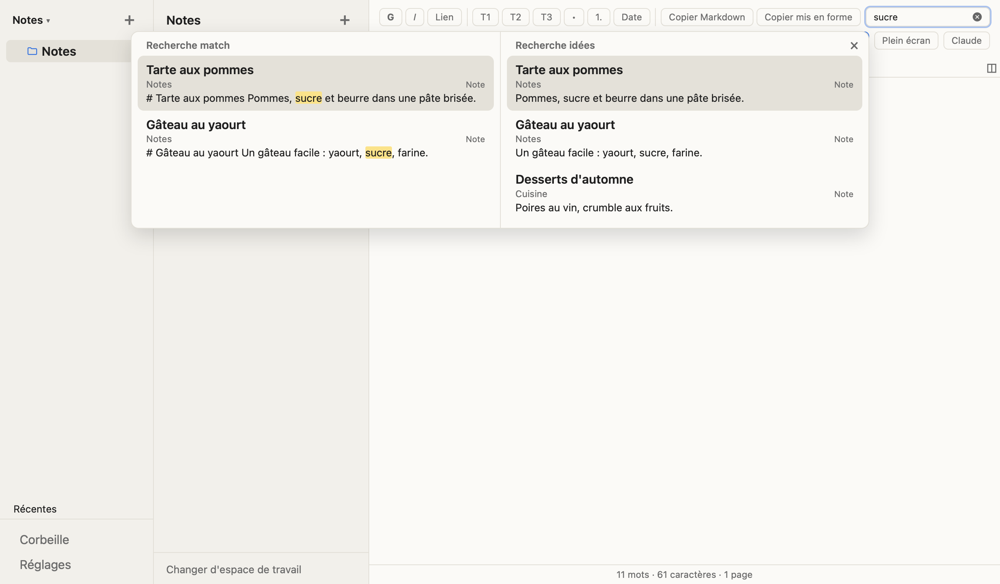

# Recherche en fenêtre

Spécification fonctionnelle (24/11/2026), demandée par l'utilisateur. Elle remplace l'affichage des résultats dans la liste des notes et le choix « Par les mots / Par le sens » sous le champ. Ce document se lit seul.

## 1. Besoin

Voir d'un coup, pour les mêmes mots tapés, ce que la recherche par les mots trouve et ce que la recherche par le sens trouve, sans changer de mode.

## 2. Comportement

- **Le champ de recherche est dans la bande du haut**, entre la barre de mise en forme et les boutons « Focus », « Plan »… Il n'est plus au-dessus de la liste des notes, qui montre toujours les notes du dossier, de l'étiquette, de Récentes ou de la corbeille.
- **Les résultats s'affichent dans une fenêtre de recherche**, posée sous le champ, par-dessus la page, à deux colonnes :
  - à gauche **« Recherche match »** : les notes qui contiennent les mots tapés (la recherche par les mots d'aujourd'hui : même règle, même tri, extrait avec les mots surlignés) ;
  - à droite **« Recherche idées »** : les notes dont le sens est le plus proche des mots tapés (la recherche par le sens, seule, sans mêler les mots), la plus proche d'abord, avec l'extrait du passage trouvé.
- **Les deux colonnes se remplissent pour la même recherche**, tapée dans le champ du haut. La recherche part après une courte pause dans la frappe, dès le seuil de recherche atteint (3 caractères, ou un nombre) ; en dessous, la fenêtre reste fermée. La fenêtre s'ouvre à la première réponse attendue (« Recherche… ») et se met à jour à chaque nouvelle recherche.
- **Un résultat s'ouvre comme avant** : un clic ouvre la note (une carte mentale, avec le nœud trouvé), un Cmd+clic l'ouvre dans un nouvel onglet, un clic droit propose le menu d'une note. Ouvrir une note ferme la fenêtre et vide le champ.
- **Fermer** : Échap (dans le champ ou dans la fenêtre), la croix de la fenêtre, un clic en dehors, ou vider le champ. Fermer vide le champ.
- **Une colonne sans résultat** dit « Aucune note trouvée ».
- **Le sens manque** (modèle de sens non téléchargé) : la colonne « idées » le dit (« Le modèle « E5 petit » n'est pas téléchargé : la recherche par le sens en a besoin. ») et renvoie aux **Réglages > Index** par un bouton qui ouvre l'onglet « Index » des réglages. La colonne « match » répond seule. Le téléchargement ne se propose plus dans la fenêtre.
- **Le sens n'est pas encore calculé** (calcul en cours, ou pas commencé) : la colonne « idées » dit « Calcul du sens : 120 / 411 segments » et montre ce qui est déjà trouvé ; elle se met à jour à la fin du calcul.
- **Une erreur du sens** est dite dans la colonne « idées » ; la colonne « match » répond quand même.
- **Chaque colonne range ses résultats en sections de résultats** (fiche 0093), sous un titre discret avec leur nombre, dans cet ordre : « Canvas », « Cartes mentales » (cartes et nœuds), « Cahiers de recherche » (cahiers et entrées), « CRM » (le CRM et ses fiches : action, projet, personne, entreprise, dont le type reste écrit à droite de chaque résultat), puis « Notes » en dernier, parce qu'elles sont bien plus nombreuses. Exemple : « Canvas (1) », « Cartes mentales (2) », « CRM (1) », « Notes (2) ». Une section sans résultat n'apparaît pas ; dans une section, l'ordre est celui de la colonne ; un contenu d'un type inconnu est rangé dans « Notes ». Un titre de section n'est pas un résultat : on ne le clique pas, on ne le choisit pas.
- Les résultats des deux colonnes ont la forme actuelle d'un résultat de recherche : titre, dossier, type de contenu (« Note », « Cahier de recherche », « Entrée », « Nœud »…), extrait. Au plus 100 par colonne.

## 3. Ce qui disparaît

- Le choix « Par les mots / Par le sens » sous le champ, la barre de téléchargement du modèle qui s'y trouvait, et la commande « Rechercher par le sens » (palette et barre des menus) : « Rechercher dans toutes les notes » met le curseur dans le champ, et les deux recherches répondent toujours.
- L'affichage des résultats dans la liste des notes.

## 4. Ce qui ne change pas

- L'outil de recherche de Claude (par les mots, par le sens) et la recherche de nœuds dans les cartes mentales.
- La recherche dans la note (Cmd+F) : autre fonction.
- Les notes proches, les réglages « Index » (choix du modèle, téléchargement, reconstruction).
